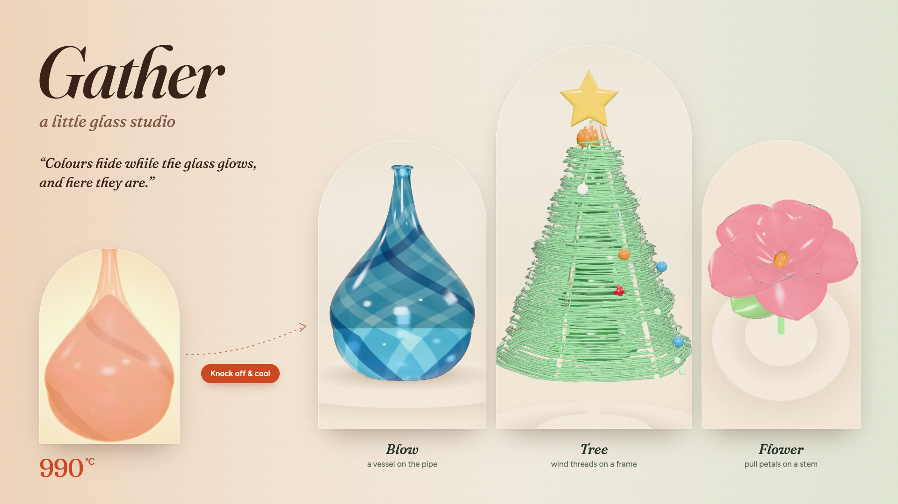
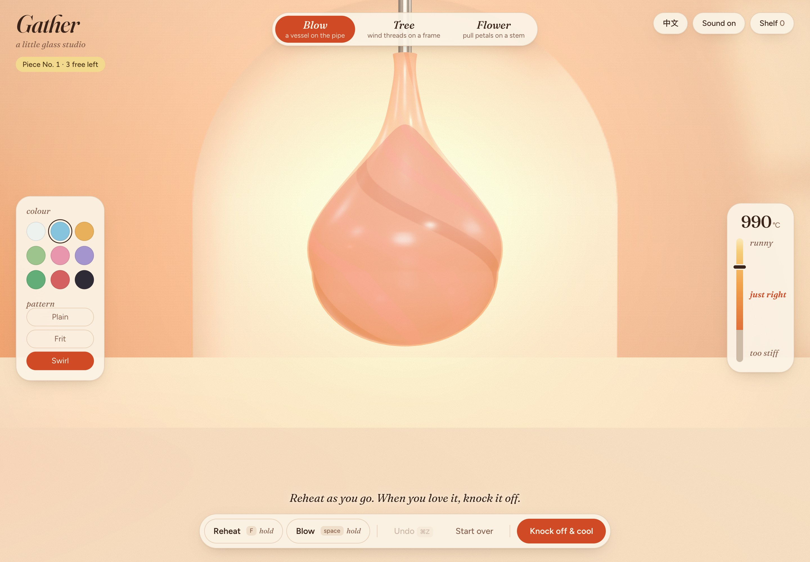
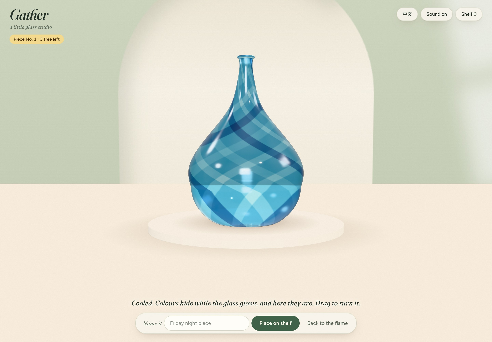
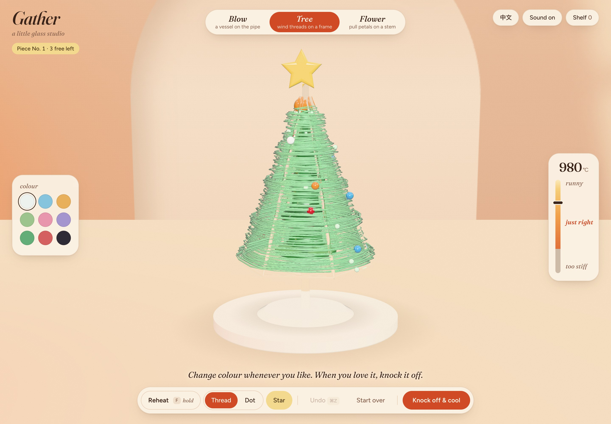
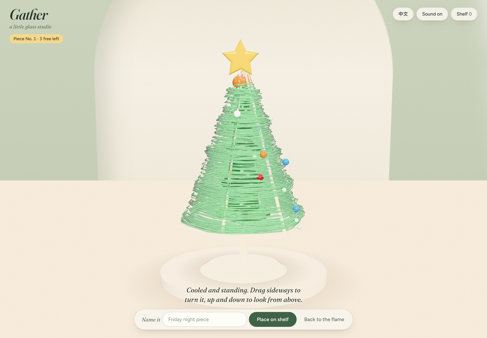
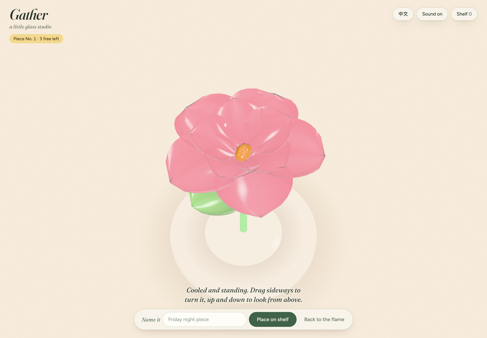

# Gather

English · [简体中文](README.zh-CN.md)

**A little glass studio in your browser. Blow a small vessel, wind a spun-glass Christmas tree, or pull a glass flower petal by petal, then name it and keep it on your shelf.**

[Open the studio →](https://cynthiawongss.com/gather-glass-studio/)



*Every piece here was made by hand in the live app and captured with the interface hidden. The vessel on the left and the blue one beside it are the same piece, before and after cooling.*

Most glass games in the browser lean towards simulation: scores, orders, a dozen tools. Gather is about one thing: making a piece you like enough to keep. You heat the glass, shape it with your own hands, knock it off when it feels right, and it waits on your shelf.

## Why it looks like this

| Idea | What you see |
| --- | --- |
| Hot glass hides its colour | While you work, every piece glows orange. The colour you picked only shows after **Knock off & cool**: "Colours hide while the glass glows, and here they are." |
| The room follows the glass | The whole interface is warm by the furnace, with a tomato-red accent, and turns calm and bottle green once the piece has cooled. |
| The piece is the screen | The glass fills the window. Colours, the thermometer and the tools sit around the edges like paper tags. |
| Real craft, simplified | The steps come from real glassblowing (gather, reheat, blow, shape, knock off, cool slowly) and from how lampworkers wind a spun-glass tree onto a cone frame. Fresh thread glows orange-red for a moment, and each thread ends in a small drop. Temperatures and timings are simplified; this is not a lesson in glassworking. |
| Made by hand | There is no AI anywhere in Gather. Every shape comes from your pointer. |

| While it glows | After cooling |
| --- | --- |
|  |  |

## Three ways to make

| Workshop | What you do | What you keep |
| --- | --- | --- |
| **Blow** · a vessel on the pipe | Pick one of 9 colours and a pattern (**Plain**, **Frit** or **Swirl**). Hold **Reheat** to soften the glass and **Blow** to inflate it. Drag its side outward to belly it or inward to pinch a waist; drag the base to stretch it. | A small blown vessel in your own proportions |
| **Tree** · wind threads on a frame | A cone frame stands on the rod. Hold beside it with **Thread** and glass winds on at the height of your pointer, about five turns a second. Move slowly up and down to build layers; change colour whenever you like. Add beads with **Dot** and finish with a **Star**. | A spun-glass Christmas tree made of hundreds of turns of thread |
| **Flower** · pull petals on a stem | With **Petal**, press on the stem and drag outward: the farther you drag, the longer the petal; drag upward to cup it. Let go and the stem turns for the next one, so five make a flower and the next five fall into the gaps. Dot the centre, then pull green petals lower down for leaves. | A glass flower shaped one petal at a time |

The glass cools as you work. A thermometer shows the temperature and whether it is **runny**, **just right** or **too stiff**; when it stiffens, reheat. Too hot, and a vessel starts to droop. In the tree, hot glass gives hair-fine threads and cooling glass gives thick ones.

## An example: a Christmas tree

This fictional tree took about 35 seconds of winding in the live app.

1. Choose **Tree** and the **Pine** colour. Hold **Reheat**, then hold beside the frame with **Thread** and move slowly from the bottom to the top and back. Linger in a few places and the thread builds a ledge there, like the tiers of a tree.
2. Switch to **Dot** and click the tree to add beads in **Berry**, **Amber**, **Sea** and **Clear**.
3. Pick **Clear** and press **Star**. A clear star comes out golden.
4. **Knock off & cool**, then name it and **Place on shelf**.

| At the flame | Cooled and standing |
| --- | --- |
|  |  |

The flower below was made the same way: five long rose petals, five shorter ones in the gaps, one green leaf and an amber centre.



## Keep it

- **Place on shelf** keeps the piece in this browser. Open the **Shelf** to turn a piece around, rework it, delete it, or **Save as card**, which downloads a 1080 × 1350 PNG with its name and date.
- A piece you are still making is saved as a draft. Refresh or close the page and it is waiting when you come back.
- Switching workshop starts a new piece, so place the current one on the shelf first.
- Keys: hold **F** to reheat, hold **Space** to blow, **⌘Z** to undo.
- The interface is in English and Chinese.

## Limits

| Current behaviour | What it means |
| --- | --- |
| Stored in this browser only | No account or sync. Clearing site data or changing browser empties the shelf. |
| "3 free pieces" is a demo | The counter lives in your browser. The unlock button in the dialog charges nothing; no payment is connected. |
| Simplified glass | Heat, cooling and shaping are tuned to feel right, not to teach the craft. The winding speed and thread behaviour are estimates that no one has tested by hand yet. |
| Not yet tried everywhere | Checked in desktop Chromium. Safari, a real trackpad pinch, sound on real speakers and phones have not been tried. |
| Needs the internet | three.js and the fonts load from the web. |

## Run it locally

```bash
python3 -m http.server 5178 --bind 127.0.0.1
```

Then open http://localhost:5178/ in Chrome or Safari. There is no build step; three.js 0.187.0 is pinned in the import map in `index.html`.

| File | What it does |
| --- | --- |
| `src/model.js` | Piece data and shaping rules |
| `src/stage.js` | The three.js scene, glass geometry and materials, the card export |
| `src/main.js` | Workshop states, input and interface |
| `src/coil.js` | Turns a path of points into a thin glass thread |
| `src/store.js` | The shelf and the demo counter, in local storage |
| `src/audio.js` | Three synthesised sounds: the flame, breath and a glass "tink" |
| `src/i18n.js` | English and Chinese text |
| `research/research.md` | Research notes on the craft and the design decisions |
| `lab/coil.html` | A rendering experiment for the thread, not part of the studio |
