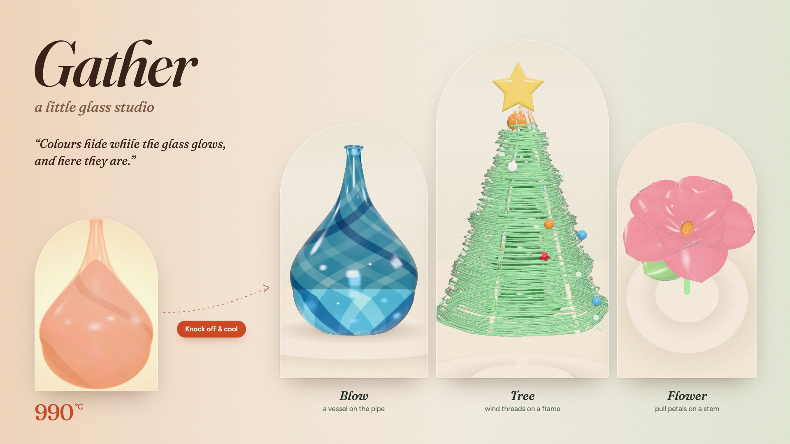
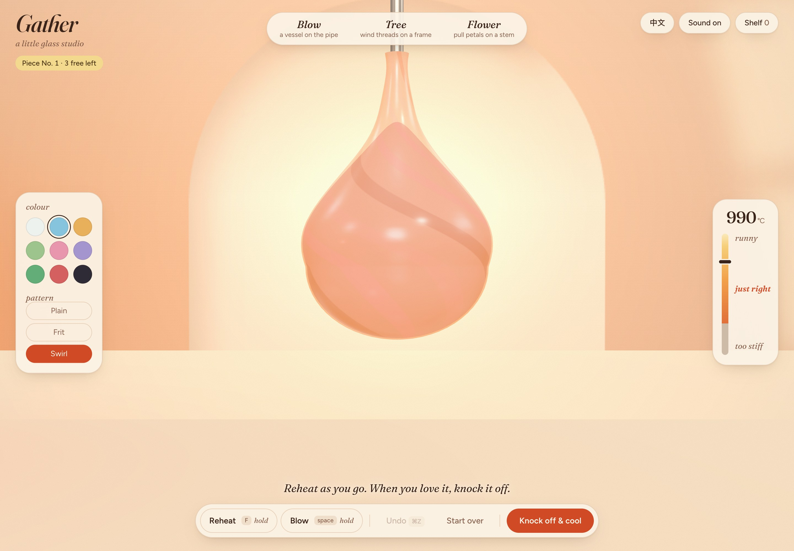
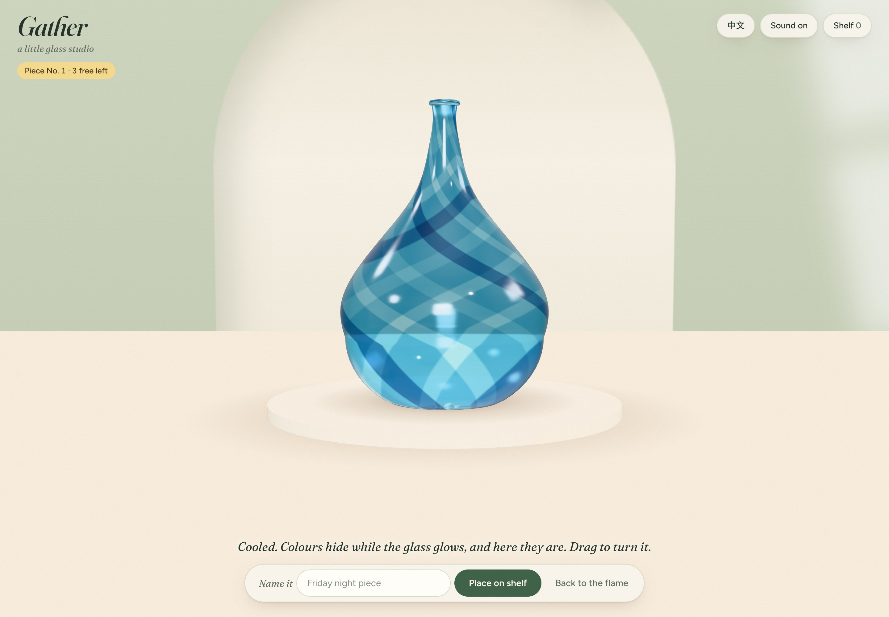
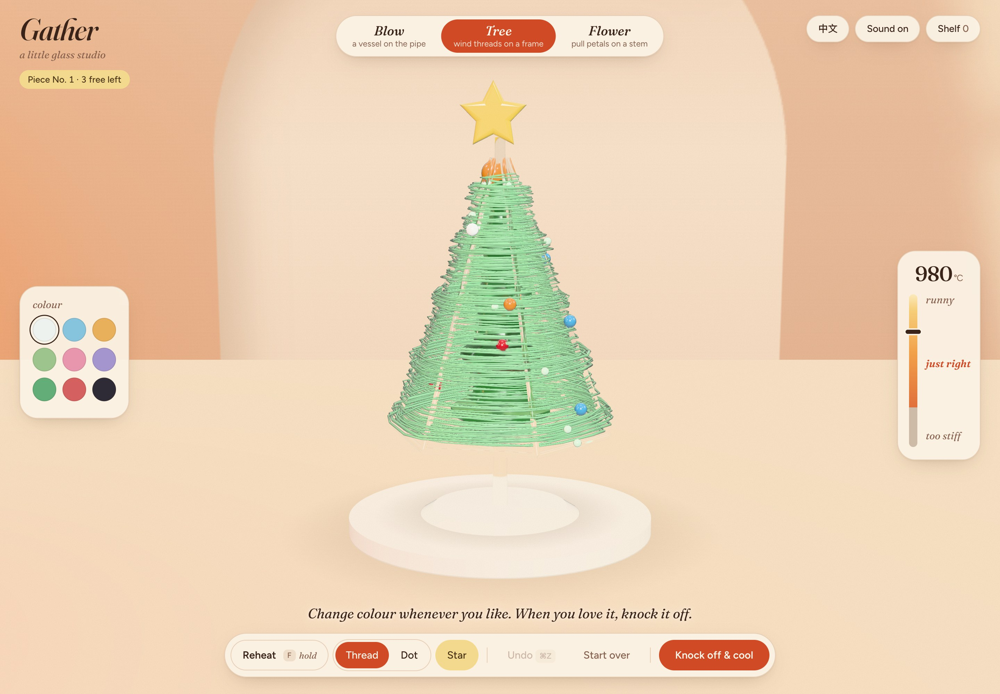
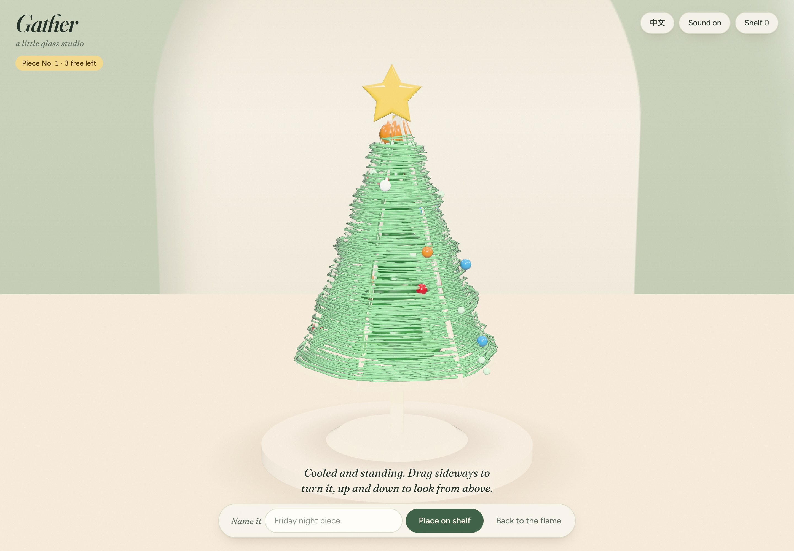
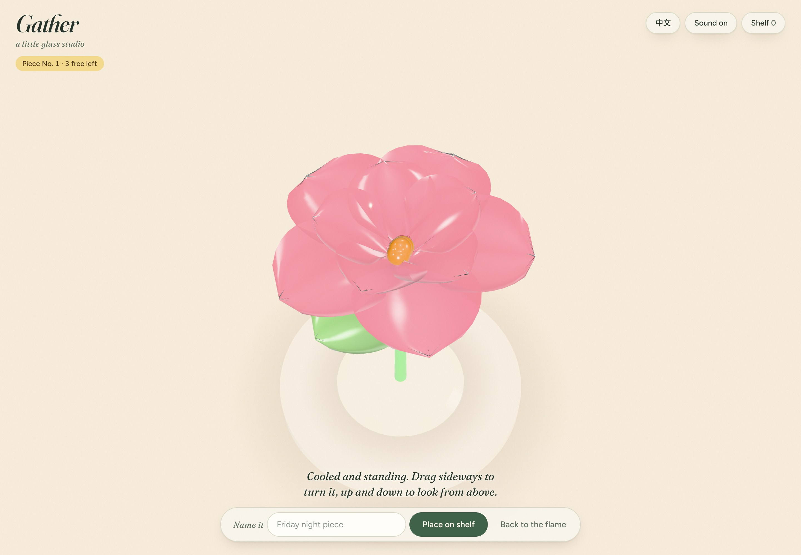

# Gather

[English](README.md) · 简体中文

**一间开在浏览器里的小小玻璃工作室。吹一只小瓶，缠一棵拔丝玻璃圣诞树，或者一片片拉出一朵玻璃花，然后给它起个名字，放上自己的陈列架。**

[打开工作室 →](https://cynthiawongss.com/gather-glass-studio/)



*图里每一件都是在实际网站里亲手做的，截图时隐藏了界面。左边那只和它旁边的蓝瓶是同一件作品，分别是凉之前和凉之后。*

浏览器里的玻璃游戏大多往"模拟器"走：评分、订单、十几种工具。Gather 只关心一件事：做出一件你喜欢到想留下来的作品。把玻璃烧软，亲手塑形，觉得对了就敲下来，它会在陈列架上等你。

## 为什么是这个样子

| 想法 | 你看到的 |
| --- | --- |
| 热玻璃看不出颜色 | 制作的时候，每件作品都发着橙光。选好的颜色要等 **敲下定型** 之后才显出来：网站里写的是"热的时候看不出的颜色，现在出来了。" |
| 房间跟着玻璃变 | 整个界面在炉边是暖的，强调色是番茄红；作品凉透以后，整个画面变得安静，换成瓶子绿。 |
| 作品就是整个屏幕 | 玻璃占满窗口。料色、温度计和工具都像纸签一样贴在四周。 |
| 真实的工艺，简化过 | 步骤来自真实的吹制玻璃（蘸料、回炉、吹气、塑形、敲下、慢慢退火），以及灯工师傅在锥形骨架上缠拔丝圣诞树的做法。刚拉出的丝会发一会儿橙红色的光，每根丝的尾巴会留下一颗小水滴。温度和时间都是简化的，这不是玻璃工艺教学。 |
| 全靠手做 | Gather 里没有任何 AI。每一个形状都来自你的鼠标或触控板。 |

| 发着光的时候 | 凉透以后 |
| --- | --- |
|  |  |

## 三种做法

| 做法 | 怎么做 | 留下什么 |
| --- | --- | --- |
| **吹制** · 在吹管上吹一只瓶 | 从 9 种料色里选一种，再选纹样（**纯色**、**碎料** 或 **螺旋**）。按住 **回炉** 把玻璃烧软，按住 **吹气** 让它鼓起来。在玻璃侧面往外拖是拉鼓，往里拖是收腰；拖动底部可以抻长。 | 一只比例由你决定的小吹制瓶 |
| **圣诞树** · 在骨架上缠丝 | 料棒上先立着一个锥形骨架。选 **拉丝**，在它旁边按住不放，玻璃丝会缠在指针所在的高度，大约每秒五圈。慢慢上下移动，一层层叠上去；随时可以换颜色。用 **点珠** 加小珠，最后加一颗 **星星**。 | 一棵由几百圈玻璃丝缠成的拔丝圣诞树 |
| **花** · 在花茎上拉花瓣 | 选 **花瓣**，在花茎上按住往外拖：拖得越远花瓣越长，往上拖就往上兜。松手后花茎会转到下一片的位置，所以五片正好围成一朵，下一层的五片会落在上一层的缝里。在花心点一颗珠，再换绿色在花茎低一点的地方拉，就是叶子。 | 一朵一片一片拉出来的玻璃花 |

玻璃会边做边变凉。温度计显示当前温度，以及它是 **很软**、**好塑形** 还是 **拉不动**；变硬了就回炉。烧得太烫，瓶子会往下坠。做树的时候，料烧透时拉出头发丝，变凉时拉出粗带。

## 一个例子：一棵圣诞树

这棵虚构的树，在实际网站里缠了大约 35 秒。

1. 选 **圣诞树** 和 **松绿** 料色。按住 **回炉**，再用 **拉丝** 在骨架旁按住，从下到上、再从上到下慢慢移动。在几个高度多停一会儿，丝就会在那里堆出一层檐，像树的一层层枝。
2. 换成 **点珠**，用 **莓红**、**琥珀**、**海蓝** 和 **清料** 在树上点小珠。
3. 选 **清料** 再按 **星星**。清料做的星星是金黄色的。
4. **敲下定型**，起个名字，**放上陈列架**。

| 在火边 | 凉透、立住了 |
| --- | --- |
|  |  |

下面这朵花也是这样做的：五片长长的蔷薇色花瓣，五片短一点的落在缝里，一片绿叶，再加一颗琥珀色的花心。



*截图是网站的英文界面；右上角切换到中文后，所有文字都会变成中文。*

## 留下来

- **放上陈列架** 会把作品存在这个浏览器里。打开 **陈列架** 可以转着看、回炉再改、删除，或者 **存成卡片**：下载一张 1080 × 1350 的 PNG，上面有作品名和日期。
- 还在做的作品会存成草稿。刷新或关掉页面，回来时它还在。
- 换一种做法就会开始一件新作品，所以先把手上这件放上陈列架。
- 快捷键：按住 **F** 回炉，按住 **空格** 吹气，**⌘Z** 撤销。
- 界面支持英文和中文。

## 限制

| 当前行为 | 意味着什么 |
| --- | --- |
| 只存在这个浏览器里 | 没有账号，也没有同步。清除网站数据或换浏览器，陈列架就空了。 |
| "3 件免费"是演示 | 计数存在你的浏览器里。弹窗里的解锁按钮不会扣钱，也没有接入任何支付。 |
| 简化过的玻璃 | 加热、冷却和塑形是按"手感对"来调的，不是为了教工艺。缠丝的速度和丝的表现都是估的，还没有真人上手试过。 |
| 还没在所有环境试过 | 在桌面版 Chromium 里检查过。Safari、真实触控板的捏合、真实扬声器里的声音、手机，都还没试过。 |
| 需要联网 | three.js 和字体都从网上加载。 |
| 线上网站有统计 | 线上网站加载了 Umami，用来统计页面访问量。 |

## 本地运行

```bash
python3 -m http.server 5178 --bind 127.0.0.1
```

然后用 Chrome 或 Safari 打开 http://localhost:5178/。不需要构建；three.js 0.187.0 钉死在 `index.html` 的 importmap 里。

| 文件 | 作用 |
| --- | --- |
| `src/model.js` | 作品数据和塑形规则 |
| `src/stage.js` | three.js 场景、玻璃几何和材质、作品卡片导出 |
| `src/main.js` | 工作流程的状态、输入和界面 |
| `src/coil.js` | 把一串路径点做成一根细玻璃丝 |
| `src/store.js` | 陈列架和演示计数，存在本地存储里 |
| `src/audio.js` | 现场合成的三种声音：火焰、吹气和玻璃的"叮" |
| `src/i18n.js` | 中英文文案 |
| `research/research.md` | 工艺调研和设计决定 |
| `lab/coil.html` | 调玻璃丝画面用的实验页，不是工作室的一部分 |
